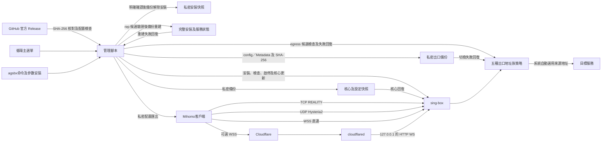

# 三合一管理與連線

直連端口由 1Panel／供應商防火牆決定可達範圍。Argo 不覆蓋 REALITY 或 Hysteria2 的直連入口。

`agsbx` 無參數顯示狀態及命令，`tri-proxy` 保留循環選單。`rep` 是三協定參數重建，成功後客戶端須重新匯入；空端口沿用原端口。

`egress` 切換保留入口、身份、憑證及客戶端匯出；`rep` 未指定 `EGRESS_MODE` 時沿用原策略。出口 IPv6 毋須填入，VPS 須已配置可用 IPv6；策略不涵蓋 REALITY 握手、cloudflared、DNS 傳輸或 VPS 其他程式。
